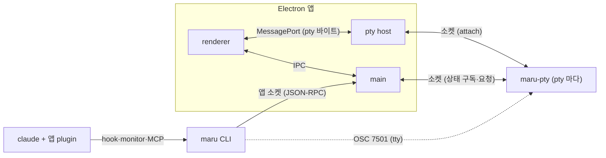

# Architecture

AI Maru 의 큰 구조 — 프로세스, 각자 가진 상태, 연결, 화면의 층 — 를 적는다. 여러 코드가 함께 지키는 계약은 `docs/contracts/` 에 있다. 이 문서나 계약 문서가 코드와 다르면 코드가 맞다.

## 화면의 층

- **workspace** — 창이 사이드바에 보이는 목록의 한 줄이다. cell 을 묶는다.
- **cell** — pane 배치를 갖고 선택의 단위다. job 도 cell 에 속한다. Canvas 문서는 cell 이나 pty 에 붙는다.
- **pane** — cell 을 나눈 화면 영역이다. pane 마다 pty 하나를 보인다. pane id(`n-…`)는 앱을 다시 띄워도 그대로다.
- **pty** — 셸과 그 안의 프로그램이 도는 터미널이다. `maru-pty` 프로세스 하나가 pty 하나를 든다. pty id 는 `p-…` 다.
- **job** — pane 없이 도는 pty 다.

## 프로세스

| 프로세스 | 가진 것 |
| --- | --- |
| renderer | 화면(workspace·cell·pane 배치, 보기 설정), xterm 으로 그린 터미널, Canvas 문서. 화면이 바뀔 때마다 main 에 알린다. |
| main | 디스크의 상태(`state.json`), job 표, pty 마다의 마지막 상태와 알림, 설정(`~/.ai-maru`), `maru` 가 붙는 앱 소켓. 창과 끄기·재시작을 정한다. |
| pty host | pane 의 pty 를 띄우고 붙어, renderer 와 `maru-pty` 사이의 바이트를 잇는다. Electron 의 utility process 다. |
| `maru-pty` | pty 장치와 그 위의 셸, libghostty-vt 로 해석한 화면·scrollback, cwd·제목·프로그램 상태 레코드. 자기 레코드 파일과 소켓을 앱의 run 디렉토리에 둔다. |
| `maru` CLI | 앱 터미널 안의 프로그램이 앱을 부르는 명령이다. 앱은 pty 마다 `MARU_SOCKET`·`MARU_PTY_ID` 를 넣는다. |
| claude plugin | 앱 터미널에서 띄운 claude 에 앱이 싣는 plugin 이다. hook·monitor·MCP 서버가 모두 `maru` 를 부른다. |

## 연결

- **renderer ↔ main** — Electron IPC. 화면 상태, pane·cell 요청과 답, pty 상태의 push 가 오간다.
- **renderer ↔ pty host** — main 이 만들어 양쪽에 넘긴 MessagePort. pty 의 입출력 바이트가 오간다.
- **앱 ↔ `maru-pty`** — pty 마다의 Unix 소켓. pty host 는 화면을 붙이고(attach), main 은 상태를 구독하고 끄기 같은 짧은 요청을 보낸다. 요청에는 프로토콜 버전을 싣는다.
- **`maru` → main** — 앱 소켓의 줄 단위 JSON-RPC. 요청마다 연결 하나다. monitor 의 구독만 연결을 잇는다.
- **터미널 안의 프로그램 → `maru-pty`** — 터미널 출력. 셸의 cwd(OSC 7), 알림(OSC 9·777), 프로그램 상태(OSC 7501)를 `maru-pty` 가 해석한다. `maru status` 도 앱 소켓이 아니라 이 경로로 쓴다.

## 이렇게 나눈 이유

- **pty 마다 `maru-pty` 프로세스를 둔다.** 앱이 끝나거나 재시작해도 셸과 그 안의 프로그램, 화면이 살아남고, 다시 뜬 앱이 그 pty 에 붙는다.
- **pty 바이트는 main 을 지나지 않는다.** 출력이 쏟아져도 main 이 막혀 창 조작까지 멈추지 않게 하기 위해서다.
- **main 이 pty 상태를 직접 구독한다.** renderer 의 attach 연결은 화면이 붙은 동안에만 있다. `maru` 의 목록·데스크톱 알림은 renderer 없이 답해야 한다.
- **프로그램 상태의 주인은 `maru-pty` 다.** 앱이 꺼진 동안 쓴 상태도 남고, 다시 뜬 앱이 그대로 받는다.
- **`state.json` 은 표마다 형식 버전을 둔다.** 재시작하면 다른 빌드가 같은 파일을 읽으므로, 한 표의 형식이 바뀌어도 그 표만 잃게 한다.
- **claude 연동은 모두 `maru` 를 거친다.** hook·monitor·MCP 서버가 `maru` 의 하위 명령이고 앱에는 앱 소켓으로 닿는다. 그래서 앱에 HTTP 서버를 따로 두지 않는다.

## 계약 문서

| 파일 | 다루는 것 |
| --- | --- |
| [`pty-lifecycle.md`](contracts/pty-lifecycle.md) | pty 를 열고 붙고 끄는 순서, 앱을 끌 때와 다시 뜰 때의 pty |
| [`cell-and-window-requests.md`](contracts/cell-and-window-requests.md) | pty 의 cell, 창에 보내는 pane·cell 요청, job 표, 닫기 확인 |
| [`pty-state.md`](contracts/pty-state.md) | pty 상태와 알림의 구독, `pane list`·`pty list`, 프로그램 상태 레코드 |
| [`versions-and-persistence.md`](contracts/versions-and-persistence.md) | 프로토콜 버전, `state.json` 의 표와 형식, 재시작 |
| [`claude-integration.md`](contracts/claude-integration.md) | claude shim, `maru mcp` 중계 |
| [`terminal-grid-and-replay.md`](contracts/terminal-grid-and-replay.md) | 글자 칸 격자, 글자 폭, attach 크기와 재동기화 |

`maru` 의 요청 형식은 `core/crates/maru/src/main.rs`, `maru-pty` 의 소켓 프로토콜은 `core/crates/maru-pty/src/lib.rs` 의 모듈 문서에 있다. 설정은 `docs/config.md` 에 있다.
